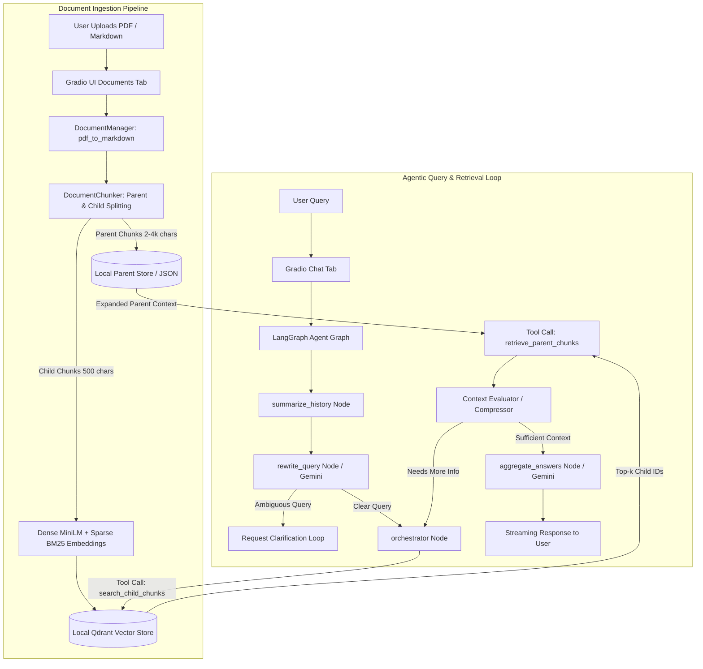

# Agentic RAG — Document Question Answering System

An intelligent, production-ready **Agentic Retrieval-Augmented Generation (RAG)** system built with **LangGraph**, **LangChain**, **Qdrant**, and **Google Gemini**. The system features parent–child chunking, hybrid (dense + sparse BM25) retrieval, multi-turn query rewriting, and an interactive **Gradio** web application.

---

## Table of Contents

- [Overview](#overview)
- [Key Features](#key-features)
- [Architecture & Workflow](#architecture--workflow)
- [Technology Stack](#technology-stack)
- [Repository Structure](#repository-structure)
- [Prerequisites](#prerequisites)
- [Installation (Windows PowerShell)](#installation-windows-powershell)
- [Environment Configuration](#environment-configuration)
- [Running the Application](#running-the-application)
- [Usage Guide](#usage-guide)
- [Vector Database & Parent Store Architecture](#vector-database--parent-store-architecture)
- [Testing & Validation Status](#testing--validation-status)
- [Troubleshooting](#troubleshooting)
- [Security & Privacy](#security--privacy)
- [Limitations & Future Improvements](#limitations--future-improvements)
- [License & Attribution](#license--attribution)

---

## Overview

Traditional RAG pipelines rely on single-shot retrieval and basic chunking, frequently resulting in fragmented context, irrelevant retrieval results, or hallucinated answers. 

This **Agentic RAG** system solves these challenges by implementing an autonomous agent workflow powered by **LangGraph**:
1. **Understands & Refines**: Evaluates incoming queries, clarifies ambiguous questions, and rewrites queries for optimal retrieval.
2. **Hybrid Search**: Leverages dense vector embeddings (`all-MiniLM-L6-v2`) together with sparse lexical embeddings (`Qdrant/bm25`) within a local **Qdrant** database.
3. **Parent–Child Context**: Retains granular child chunks for high-precision vector matching, while retrieving rich parent sections for grounded synthesis by **Google Gemini**.

---

## Key Features

- **Document Ingestion**: Seamlessly processes both PDF (`.pdf`) and Markdown (`.md`) files via the web interface.
- **PDF Text Extraction**: Uses `PyMuPDF` (`pymupdf4llm`) for high-fidelity Markdown extraction with table and layout preservation.
- **Parent–Child Chunking**: Splits parent document sections (2,000–4,000 characters) into linked child chunks (500 characters, 100 overlap) to maximize both retrieval precision and answer context.
- **Dense Semantic Retrieval**: High-speed, local vector embeddings generated using `sentence-transformers/all-MiniLM-L6-v2` (no external API calls required for embeddings).
- **Sparse BM25 Retrieval**: FastEmbed-powered sparse token weighting (`Qdrant/bm25`) for exact keyword and term matching.
- **Hybrid Retrieval**: Combines dense semantic similarity and sparse BM25 scores directly in Qdrant using Reciprocal Rank Fusion (RRF) / hybrid scoring.
- **Local Vector Storage**: Embedded, file-based **Qdrant** instance requiring no external database servers or Docker containers.
- **File-Backed Parent Store**: Dedicated disk storage for parent chunks ensuring immediate, lightweight contextual expansion.
- **Gemini-Powered Generation**: Leverages Google's `gemini-3.8-flash` via `langchain-google-genai` for structured query rewriting, context compression, and multi-document synthesis.
- **LangGraph Agent Workflow**: StateGraph architecture featuring conversational memory, query rewriting, tool calling, context compression, and human-in-the-loop clarification loops.
- **Interactive Web Interface**: Polished **Gradio** UI featuring document upload management and streaming multi-turn chat.

---

## Architecture & Workflow

The following flow diagram illustrates the end-to-end data ingestion and agentic query loop:



---

## Technology Stack

| Technology | Role & Purpose |
|------------|----------------|
| **Python 3.11** | Core runtime environment ensuring binary compatibility for ML wheels. |
| **LangGraph** (`>=1.2`) | State graph orchestration, cyclical agent execution, and memory checkpoints. |
| **LangChain** (`>=1.4`) | Unified abstraction layer for LLMs, prompts, tools, and message schemas. |
| **Google Gemini** (`gemini-3.8-flash`) | Fast, capable LLM provider for query analysis, tool decisioning, and grounded answers. |
| **Qdrant** (`langchain-qdrant`, `qdrant-client`) | Embedded vector database managing hybrid dense and sparse BM25 indices. |
| **Sentence-Transformers** | Local dense semantic embedding generation (`all-MiniLM-L6-v2`, 384 dimensions). |
| **FastEmbed** | Local sparse vector generation for BM25 keyword matching (`Qdrant/bm25`). |
| **PyMuPDF / PyMuPDF4LLM** | High-performance PDF extraction converting layout and text to Markdown. |
| **Gradio** (`>=6.26`) | Web application framework providing Document management and Chat interfaces. |
| **python-dotenv** | Secure environment configuration loading. |
| **Langfuse** *(Optional)* | Tracing and observability integration for agent execution inspection. |

---

## Repository Structure

```
Agentic-RAG-main/
├── README.md                     # Comprehensive project documentation
├── requirements.txt              # Pinned Python package dependencies
├── LICENSE                       # MIT License
├── .gitignore                    # Git exclusion rules (credentials, DBs, venvs)
├── assets/                       # UI assets and logos
├── notebooks/                    # Research and prototyping notebooks
│   ├── agentic_rag.ipynb
│   ├── evaluation.ipynb
│   ├── observability.ipynb
│   └── data/
├── project/
│   ├── app.py                    # Main application entry point (Gradio launcher)
│   ├── config.py                 # Central configuration hub (models, paths, chunking)
│   ├── utils.py                  # Text extraction, PDF converters, token estimators
│   ├── document_chunker.py       # Hierarchical parent-child document splitting
│   ├── .env.example              # Environment variables template
│   ├── core/
│   │   ├── chat_interface.py     # Streaming chat controller and response formatting
│   │   ├── document_manager.py   # Document ingestion, conversion, and deduplication
│   │   ├── execution_logger.py   # Graph execution logging utilities
│   │   ├── observability.py      # Langfuse callback handler
│   │   └── rag_system.py         # Subsystem bootstrap and graph compilation
│   ├── db/
│   │   ├── parent_store_manager.py # File-backed JSON parent chunk store
│   │   └── vector_db_manager.py    # Local Qdrant client wrapper & hybrid collections
│   ├── rag_agent/
│   │   ├── edges.py              # Conditional routing logic
│   │   ├── graph.py              # LangGraph compilation & checkpointing
│   │   ├── graph_state.py        # Graph state definitions (State, AgentState)
│   │   ├── nodes.py              # Node functions (summarize, rewrite, orchestrate)
│   │   ├── prompts.py            # Structured system instructions
│   │   ├── schemas.py            # Pydantic schemas (QueryAnalysis)
│   │   └── tools.py              # Search and parent retrieval tools
│   └── ui/
│       ├── css.py                # Custom styling for Gradio UI
│       └── gradio_app.py         # Tabbed Gradio interface layout & handlers
```

---

## Prerequisites

- **Operating System**: Windows 10/11, Linux, or macOS.
- **Python**: **Python 3.11** (recommended; Python 3.11 ensures full wheel compatibility with PyTorch, Sentence-Transformers, and onnxruntime on Windows).
- **Google Gemini API Key**: A valid API key obtained from [Google AI Studio](https://aistudio.google.com/).

---

## Installation (Windows PowerShell)

Follow these steps to set up the project locally:

1. **Clone the Repository**:
   ```powershell
   git clone <YOUR_REPOSITORY_URL>
   cd Agentic-RAG-main
   ```

2. **Create a Dedicated Python 3.11 Virtual Environment**:
   ```powershell
   py -3.11 -m venv .venv
   ```

3. **Activate the Virtual Environment**:
   ```powershell
   .\.venv\Scripts\Activate.ps1
   ```
   *(If prompted with an execution policy error, run `Set-ExecutionPolicy -ExecutionPolicy RemoteSigned -Scope CurrentUser`)*

4. **Install Dependencies**:
   ```powershell
   python -m pip install --upgrade pip
   pip install -r requirements.txt
   ```

---

## Environment Configuration

1. Copy the example environment file:
   ```powershell
   Copy-Item project\.env.example project\.env
   ```

2. Open `project/.env` in your editor and configure your Gemini API key:
   ```env
   # Required: Google Gemini API Key
   GOOGLE_API_KEY=your-actual-api-key-here

   # Optional: Langfuse Tracing
   LANGFUSE_ENABLED=false
   LANGFUSE_PUBLIC_KEY=pk-lf-...
   LANGFUSE_SECRET_KEY=sk-lf-...
   LANGFUSE_BASE_URL=http://localhost:3000
   ```

> [!WARNING]
> Never commit `project/.env` or paste your real API key into tracked repository files. The `.gitignore` file is pre-configured to exclude all `.env` files.

---

## Running the Application

To launch the Gradio web interface, run:

```powershell
.\.venv\Scripts\python.exe project/app.py
```

Upon startup, the terminal will confirm component initialization:
```text
🔨 Creating RAG Assistant...
✓ Collection already exists: document_child_chunks
Compiling agent graph...
✓ Agent graph compiled successfully.
🚀 Launching RAG Assistant...
Running on local URL:  http://127.0.0.1:7860
```

Open your browser and navigate to **`http://localhost:7860`**.

---

## Usage Guide

### 1. Ingesting Documents
1. Go to the **Documents** tab.
2. Drag and drop your `.pdf` or `.md` files into the upload area.
3. Click **Add Documents**. The system will:
   - Extract text into clean Markdown via PyMuPDF.
   - Generate parent chunks (2,000–4,000 characters) and save them to `parent_store/`.
   - Create child chunks (500 characters) with overlap.
   - Generate dense vector embeddings and sparse BM25 indices.
   - Upsert points into Qdrant.
4. Already indexed files are automatically recognized and safely skipped to avoid redundant embedding compute.

### 2. Conversational Q&A
1. Switch to the **Chat** tab.
2. Ask questions regarding your uploaded documents (e.g., *"Summarize the main findings in the report"*).
3. The agent will:
   - Expand the collapsible **Query Analysis & Rewriting** card showing query intent.
   - Run hybrid retrieval across indexed child chunks.
   - Expand parent sections for rich context.
   - Stream the grounded response directly into the conversation.

---

## Vector Database & Parent Store Architecture

| Component | Storage Path | Content Stored |
|---|---|---|
| **Local Qdrant DB** | `qdrant_db/` | `document_child_chunks` collection: 384-dimensional dense vectors (`all-MiniLM-L6-v2`) + sparse BM25 token frequencies. |
| **Parent Store** | `parent_store/` | Structured JSON documents containing the full parent section text, metadata, and parent ID references. |
| **Converted Documents** | `markdown_docs/` | Cached `.md` files converted from original source PDFs. |

---

## Testing & Validation Status

| Subsystem / Operation | Verification Status | Notes |
|---|---|---|
| **Dependency Installation** | **VERIFIED** | Clean installation of all 17 packages in Python 3.11.8 on Windows. |
| **Console Encoding** | **VERIFIED** | Configured UTF-8 stream handling preventing Windows `charmap` Unicode errors. |
| **Document Processing & Chunking** | **VERIFIED** | Successfully tested hierarchical chunking on PDF/Markdown files. |
| **Hybrid Indexing (Qdrant & BM25)** | **VERIFIED** | Successfully indexed 122 parent chunks and 1,190 child vectors. |
| **Retrieval Tools** | **VERIFIED** | Dense + sparse search (`search_child_chunks`) and parent expansion (`retrieve_parent_chunks`) verified. |
| **String/List Type Concatenation** | **VERIFIED** | Fixed and regression-tested `extract_text_content()` handling of Gemini content block lists. |
| **End-to-End Chat LLM Call** | **BLOCKED (429 Quota)** | LangGraph pipeline verified; final synthesis blocked by Gemini API free-tier daily request quota limit. |

---

## Troubleshooting

- **GoogleModelNotFoundError (404 NOT_FOUND)**:
  - *Cause*: Older model identifiers (e.g. `gemini-2.5-flash`) may be retired for new API accounts.
  - *Fix*: Ensure `LLM_MODEL = "gemini-3.8-flash"` is set in `project/config.py`.
- **429 RESOURCE_EXHAUSTED**:
  - *Cause*: Google Gemini free tier allows up to 20 requests per day for certain flash models.
  - *Fix*: Wait for quota reset or supply a key with active tier quotas in `project/.env`.
- **UnicodeEncodeError (`\u2713` / charmap codec on Windows)**:
  - *Cause*: Default Windows PowerShell terminal encoding (`cp1252`).
  - *Fix*: Handled automatically via `sys.stdout.reconfigure(encoding="utf-8")` in `project/config.py` and `project/app.py`.
- **Database Lock (RuntimeError: Storage folder is already accessed)**:
  - *Cause*: Multiple processes attempting to open local embedded Qdrant simultaneously.
  - *Fix*: Terminate any previous background Python instances before restarting `app.py`.

---

## Security & Privacy

- **Local Embeddings**: Dense and sparse embeddings run entirely locally on your machine via CPU/GPU. No document text is sent to third parties during vector indexing.
- **Git Hygiene**: `.env`, `.venv`, `qdrant_db/`, `parent_store/`, and source PDFs are strictly ignored in `.gitignore`.
- **External API Boundaries**: Only refined user queries and retrieved document context chunks are transmitted to the Google Gemini API during response generation.

---

## Limitations & Future Improvements

- **Current Limitations**:
  - Embedded Qdrant operates in single-process local mode (concurrent multi-process access requires running standalone Qdrant server).
  - Subject to external LLM provider quota limits on free-tier keys.
- **Planned Improvements**:
  - Add optional local LLM execution via Ollama (`llama3`, `mistral`) for complete offline air-gapped operation.
  - Implement dynamic reranking (e.g., FlashRank or Cohere rerankers) to further refine hybrid retrieval results.
  - Add tabular citation footnotes linking generated statements to specific document page numbers.

---

## License & Attribution

- **Original Foundation**: This repository adapts and extends the architectural concepts from the open-source [Agentic RAG for Dummies](https://github.com/GiovanniPasq/agentic-rag-for-dummies) project by Giovanni Pasqualino.
- **License**: Licensed under the **MIT License**. See the [`LICENSE`](LICENSE) file for complete copyright and permission notices.
